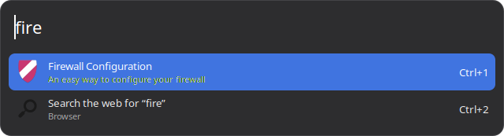
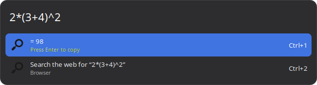

# lupa

[](https://github.com/dcotecnologia/lupa/actions/workflows/ci.yml)
[](LICENSE)


[](https://github.com/astral-sh/ruff)
[](https://github.com/astral-sh/uv)
[](https://github.com/pre-commit/pre-commit)

**Website:** <https://lupa.dcotecnologia.com/>

A small keyboard launcher for Linux desktops, written in Python and GTK3, in the spirit of
launchers such as macOS Spotlight.
Press a shortcut, type, hit Enter.




- **Apps**: prefix/substring search over installed applications, with icons.
- **Calculator**: type `2*(3+4)^2` or `sqrt(16)`; Enter copies the result.
- **Files**: searches your home directory through `plocate` (3+ characters).
- **Web**: the last row searches the web for what you typed.
- **Toggle**: running the command again closes the window, so one shortcut does both.

## Requirements

- Python 3 with PyGObject and GTK 3 (`python3-gi`, `gir1.2-gtk-3.0`)
- Optional: `plocate` for file search
- A compositing desktop (for the translucent window). Tested on Linux Mint Cinnamon, X11.

```bash
sudo apt install python3-gi gir1.2-gtk-3.0 plocate
```

## Install

The easiest way is the install script. It finds the latest release, checks it against
the sha256 that GitHub publishes for it, and installs it into `~/.local/bin`. Run the
same command again to update; it says when you already have the latest version.

```bash
curl -fsSL https://raw.githubusercontent.com/dcotecnologia/lupa/main/install.sh | sh
```

On Cinnamon it also binds **Super+Space** (and frees it from keyboard-layout switching).
On other desktops, bind a key to `/usr/bin/python3 ~/.local/bin/lupa` yourself.

To choose a version or look before it acts, save the script and run it with
`--dry-run`, `--version 0.1.0`, `--prefix DIR` or `--no-shortcut`; `./install.sh --help`
lists them. A script that you pipe into a shell runs with your rights, so read it
first if you prefer: [install.sh](install.sh). The sha256 check catches a damaged or
swapped download; it trusts GitHub and this repository, as any download from them does.

### Install a package

Every [release](https://github.com/dcotecnologia/lupa/releases/latest) also has a `.deb` and
an AppImage. They hold the same launcher; Python 3, PyGObject and GTK 3 come from your system.

| System            | File                             | How to install                                                        |
| ----------------- | -------------------------------- | --------------------------------------------------------------------- |
| Debian and Ubuntu | `lupa_<version>_all.deb`         | `sudo apt install ./lupa_<version>_all.deb`, then `lupa`              |
| Any Linux         | `Lupa-<version>-x86_64.AppImage` | `chmod +x` the file and run it (needs `python3-gi`, `gir1.2-gtk-3.0`) |

The packages do not bind a key: bind Super+Space (or another) to `lupa` in your keyboard settings.
To remove the `.deb`, run `sudo apt remove lupa`. The install script above keeps working, and is
the way to get the Super+Space shortcut set up on Cinnamon.

### Install from a checkout

```bash
git clone https://github.com/dcotecnologia/lupa.git
cd lupa
./install.sh
```

Run from a checkout, the script installs that checkout instead of a release.

### Uninstall

```bash
curl -fsSL https://raw.githubusercontent.com/dcotecnologia/lupa/main/uninstall.sh | sh
```

It removes the command and the shortcut, and gives Super+Space back to the layout switcher.

## Usage

| Key | Action |
| --- | --- |
| Super+Space | Open / close |
| Type | Search apps, files, math |
| Up / Down | Move selection |
| Enter | Run the selected row |
| Ctrl+1 … Ctrl+9 | Run the Nth row directly |
| Esc, or click elsewhere | Close |

See [docs/TUTORIAL.md](docs/TUTORIAL.md) for a walkthrough and
[docs/DOCUMENTATION.md](docs/DOCUMENTATION.md) for internals, configuration and troubleshooting.

## Contributing

See [CONTRIBUTING.md](CONTRIBUTING.md), [AGENTS.md](AGENTS.md) and [COMMITING.md](COMMITING.md);
report vulnerabilities as described in [SECURITY.md](SECURITY.md).

## Trademarks

Lupa is an independent project and is not affiliated with or endorsed by Apple Inc.
Spotlight and macOS are trademarks of Apple Inc.

## License

[MIT](LICENSE)
